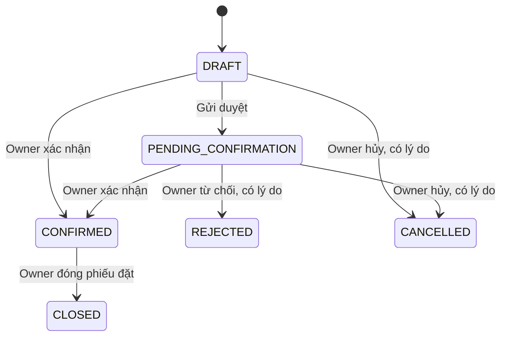

# Luồng nghiệp vụ kho đang có trong source

## Các khái niệm cần tách rõ

| Khái niệm | Ý nghĩa |
|---|---|
| Phiếu đặt (`PURCHASE_ORDER`) | Cam kết đặt nhà cung cấp; chưa phải hàng đã có trong kho. |
| Phiếu nhập (`RECEIPT`) | Một đợt nhận hàng từ phiếu đặt đã xác nhận. |
| Phiếu trả NCC (`SUPPLIER_RETURN`) | Trả một phần hàng theo phiếu nhập đã xác nhận; hiện còn chênh lệch schema. |
| Tổng tồn | stock_quantity theo detail_id (màu/size). |
| Đã xếp | Tổng quantity của các product_location. |
| Chưa xếp vị trí | Tổng tồn trừ đã xếp, không phải hàng còn thiếu từ nhà cung cấp. |
| Còn thiếu đơn đặt | Lượng đặt trừ lượng đã nhập qua receipt CONFIRMED. |

Nguồn nghiệp vụ chính: WarehouseDocuments.java, WarehouseLayout.java, WarehousePolicy.java và DocumentForm.jsx.

## 1. Tạo và xác nhận phiếu đặt

Owner chọn nhà cung cấp, biến thể, số lượng và đơn giá; có thể nhập tay hoặc đưa Excel vào form. Một phiếu có tối đa 200 biến thể, mỗi biến thể một dòng. Giá VNĐ nguyên từ 0 đến 999999999999; lượng mỗi dòng từ 1 đến 1000000.

Lưu tạo `DRAFT`; Owner có thể xác nhận trực tiếp nháp hoặc gửi `PENDING_CONFIRMATION` rồi xác nhận. Xác nhận phiếu đặt chỉ chốt chứng từ, **không cập nhật tổng tồn và không tự tạo vị trí**.

Nhà cung cấp là manufacturer_name trên phiếu đặt. Phiếu nhập/trả lấy thông tin nhà cung cấp theo chuỗi nguồn; không có bảng supplier riêng.

## 2. Nhập hàng từ đơn đặt

Chọn phiếu đặt `CONFIRMED` chưa đóng. Mỗi dòng nhập phải tham chiếu dòng nguồn có cùng detail_id; đơn giá bắt buộc bằng nguồn. Lượng nhập không vượt `quantity nguồn − lượng các receipt CONFIRMED đã nhận`. Các phiếu nháp/chờ chưa làm giảm phần còn được nhập; backend kiểm tra lại lúc submit/confirm.

Owner và Family có thể tạo receipt nháp; Family chỉ sửa/gửi receipt của mình. Khi lưu hoặc gửi duyệt, tổng tồn vẫn giữ nguyên.

Chỉ Owner confirm mới:

1. Khóa kho trong transaction và kiểm tra lại trạng thái/nguồn/lượng.
2. Cộng stock_quantity từng biến thể, kiểm tra không tràn giới hạn int.
3. Ghi stock_adjustment loại RECEIPT với idempotency key theo phiếu/dòng.
4. Ghi CONFIRMED, người và thời gian xác nhận, audit log.
5. Nếu phiếu đặt còn thiếu, tạo thông báo WAREHOUSE_SHORTAGE cho Owner ACTIVE.

Hàng vừa nhập tăng phần **chưa xếp vị trí**. Việc xếp vào kệ/tầng là thao tác tiếp theo và không tăng tổng tồn thêm lần nữa. Confirm lại một phiếu CONFIRMED trả về kết quả hiện tại thay vì cộng lại.

## 3. Trả nhà cung cấp

Luồng này có source/UI, nhưng dump chưa cho phép SUPPLIER_RETURN trong hai CHECK. Xem TASK-03 trước khi khẳng định chạy được.

Theo code: Owner chọn receipt đã CONFIRMED, chọn dòng/quantity còn được trả và ghi lý do trong note. Giá lấy từ dòng nhập. Khi xác nhận, kiểm tra tổng tồn đủ và dữ liệu vị trí không vượt tổng tồn; trừ phần chưa xếp trước, sau đó lần lượt trừ các location theo product_location_id. Ghi movement và trừ stock_quantity trong cùng transaction.

Đây không phải đổi/trả của khách hàng: `return_request`/`return_request_item` là nhóm bảng khác và chưa có module source tương ứng.

## 4. Trạng thái chứng từ

- Chỉ `DRAFT` sửa được. Không có endpoint mở lại REJECTED/CANCELLED thành DRAFT trong snapshot.
- REJECTED chỉ từ PENDING_CONFIRMATION; CANCELLED từ DRAFT/PENDING_CONFIRMATION.
- CLOSED chỉ áp dụng phiếu đặt CONFIRMED; không đóng khi còn receipt nguồn ở DRAFT/PENDING_CONFIRMATION.
- Mọi end action yêu cầu lý do. Đóng đơn không xóa lượng đã nhập và không tự nhận nốt lượng thiếu.
- Phiếu nhập đã xác nhận không hủy/sửa để đảo tồn; dùng nghiệp vụ trả phù hợp sau khi xử lý schema.
- Chưa có trạng thái REVISION_REQUESTED/RECEIVED riêng như một số luồng từng trao đổi. Không coi các tên mô tả cũ là enum đang có.

## 5. Tác động tồn theo thao tác

| Thao tác | Tổng tồn | Phân bổ vị trí |
|---|---|---|
| Lưu/submit chứng từ | Không đổi | Không đổi. |
| Confirm PURCHASE_ORDER | Không đổi | Không đổi. |
| Confirm RECEIPT | Tăng | Chưa tự xếp; phần unassigned tăng. |
| Confirm SUPPLIER_RETURN | Giảm theo code; còn TASK-03 | Ưu tiên phần unassigned, rồi trừ location nếu cần. |
| Gán hàng chưa xếp vào tầng | Không đổi | Đích tăng, unassigned giảm. |
| Chuyển giữa tầng | Không đổi | Nguồn giảm, đích tăng. |
| Rút hàng khỏi tầng về chưa xếp | Không đổi | Nguồn giảm, unassigned tăng. |
| Sửa mô tả/ảnh/bố cục | Không đổi | Quantity không đổi. |

## 6. Gán/chuyển vị trí

Owner gửi Move gồm detailId, fromLocationId hoặc null, toShelfId hoặc null, quantity, description/photoKeys khi cần và requestKey UUID. Null nguồn nghĩa là lấy hàng chưa xếp; null đích nghĩa là trả về chưa xếp. Không cho cả nguồn/đích trống hay chuyển vào chính tầng nguồn.

Backend kiểm tra quantity đủ, đúng biến thể, tổng assigned không lớn hơn stock; tầng đích/kệ phải active và tầng AVAILABLE. Lần đầu tạo location cần mô tả không trống và ảnh thực tế. Nếu location đã có, vẫn phải có mô tả và ít nhất một ảnh còn hiệu lực. Tối đa tám ảnh/location.

Movement MOVE có quantity_change=0, movement_quantity là lượng di chuyển, khóa `move:<requestKey>`. Gửi lại cùng key/nội dung không thực hiện lần hai; cùng key nhưng nội dung khác bị từ chối. Dòng location có thể còn quantity=0 để giữ metadata/lịch sử.

## 7. Kệ/tầng và sơ đồ 2D

Tọa độ x/y lưu ở rack; chiều cao kệ phụ thuộc số tầng. Tầng sắp hiển thị theo level_number giảm dần. Quy tắc hình học được viết ở cả RackGeometry.java và rackLayout.js: rộng 190, khoảng cách 24, chiều cao tầng 40 và khoảng cách tầng 4; giới hạn giá trị tọa độ 0–1800.

Có thêm/sửa kệ, thêm/sửa tầng, active/inactive, kéo kệ, đặt tương đối theo kệ khác và xếp gọn. Chỉ ẩn kệ/tầng khi không còn quantity; không có endpoint hard delete. Tầng có AVAILABLE/FULL/BLOCKED/MAINTENANCE; không có sức chứa định lượng hoặc cơ chế tự suy ra FULL từ số hàng.

Snapshot chuẩn hóa bố cục bị chồng lấn để hiển thị; các mutation bố cục còn gọi normalizeStored để lưu sửa tọa độ cũ. Vì vậy tọa độ thấy trong snapshot có thể đã được tính lại, không nhất thiết bằng giá trị thô trong bảng rack trước mutation.

## 8. Ảnh và thông báo

Ảnh kho upload JPG/PNG tối đa 5 MiB và 20 triệu pixel; backend kiểm tra nội dung/decode. Tên file phát sinh ngẫu nhiên; lưu mặc định `./data/warehouse-photos` theo working directory backend. Pattern key/read có chấp nhận webp, nhưng đường upload hiện chỉ nhận JPG/PNG; không mô tả WebP là định dạng upload được hỗ trợ.

Metadata có mô tả tối đa 2.000 ký tự, keepImageIds và photoKeys; xóa ảnh theo deleted_at. Vị trí còn hàng không được mất hết ảnh. Upload file chưa tự tạo product_location và file local không được transaction DB rollback; nếu cần quản lý file mồ côi thì phải bổ sung riêng, hiện chưa thấy job dọn.

Thông báo WAREHOUSE_PENDING sinh khi submit; WAREHOUSE_SHORTAGE sinh sau confirm receipt còn thiếu. Hiện gửi Owner ACTIVE; chưa thấy thông báo xác nhận/từ chối cho người tạo Family như một số mô tả trước. Lịch sử biến thể lấy tối đa 200 movement; danh sách thông báo tối đa 50 bản ghi.
