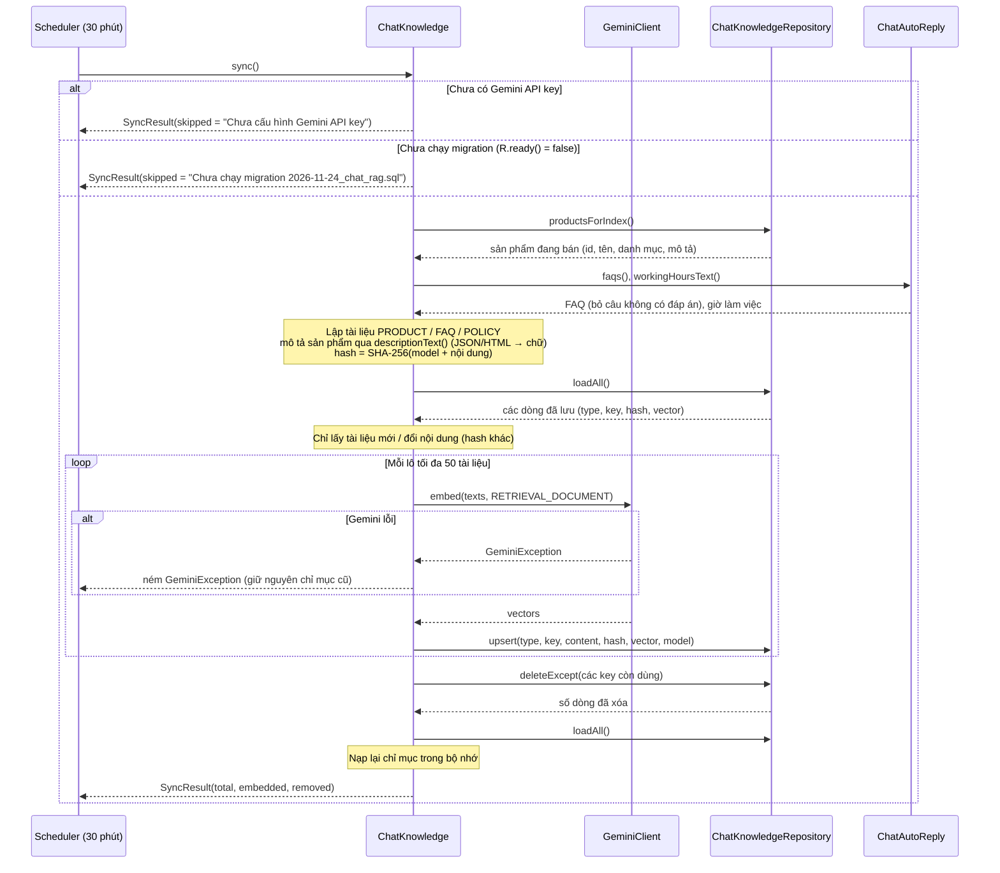
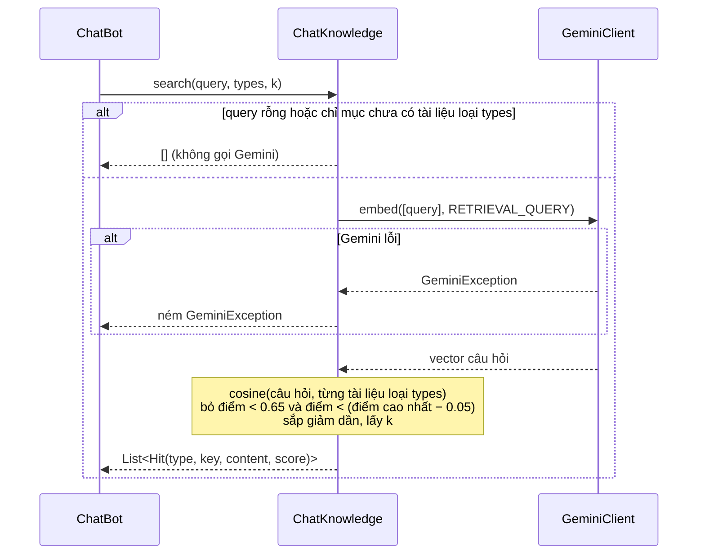
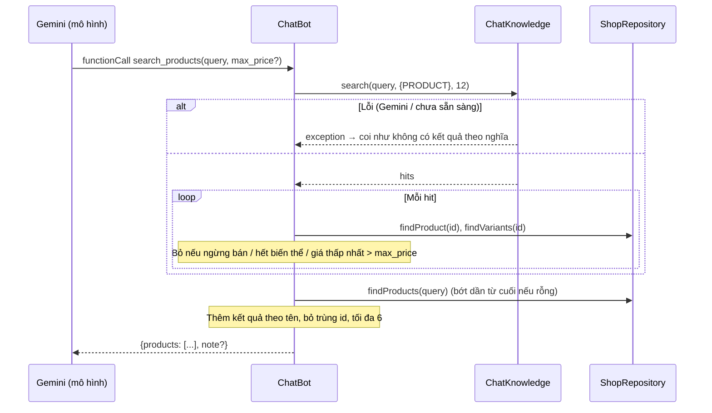
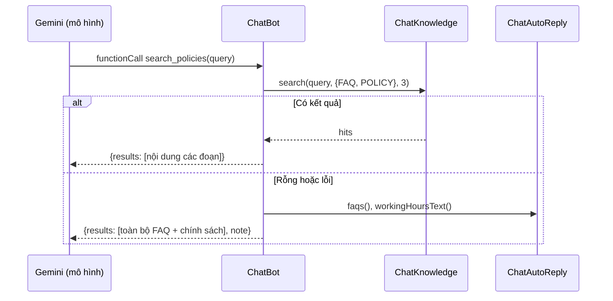
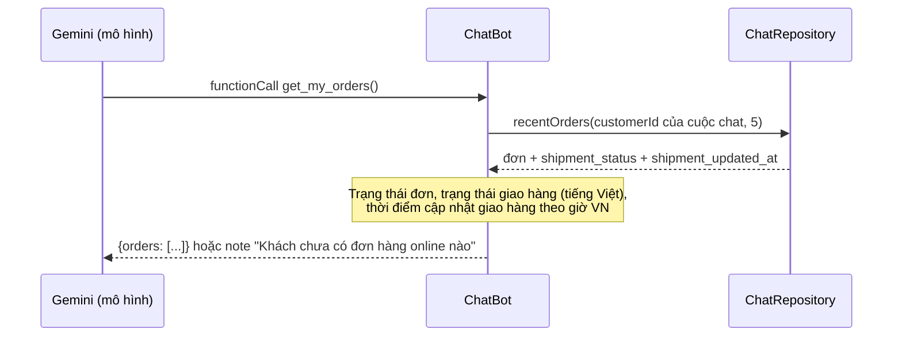
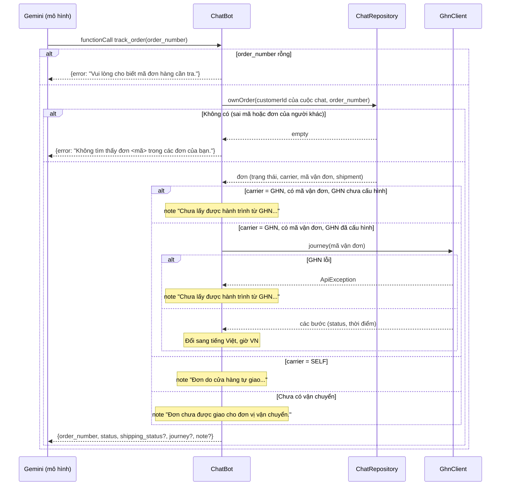
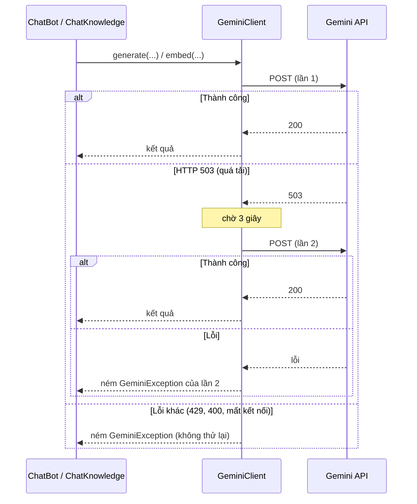

# Trợ lý AI trong chat: RAG

Trợ lý AI (Gemini) trả lời khách trong chat "Liên hệ người bán" theo kiểu **RAG (Retrieval-Augmented Generation)**:
trước khi trả lời, hệ thống **lấy dữ liệu thật** của cửa hàng rồi đưa cho Gemini, Gemini chỉ được trả lời dựa trên dữ liệu đó.

Có hai loại nguồn dữ liệu, lấy theo hai cách khác nhau:

| Nguồn | Ví dụ câu hỏi | Cách lấy (Retrieval) | Công cụ của trợ lý |
|---|---|---|---|
| Kiến thức dạng chữ: sản phẩm, FAQ, chính sách | "Có đồ gì mặc đi biển không?", "Shop có freeship không?" | **Vector search**: embedding câu hỏi, so cosine với embedding đã lưu trong bảng `chat_knowledge` | `search_products`, `search_policies` |
| Dữ liệu cá nhân, thời gian thực: đơn hàng, hành trình giao | "Đơn của mình tới đâu rồi?" | **Truy vấn chính xác**: SQL theo tài khoản khách đang chat, gọi API GHN | `get_my_orders`, `track_order` |

Đơn hàng không dùng vector search: phải đúng đơn **của chính khách đó** và đúng trạng thái **lúc này**.

## Thành phần

| Lớp | Vai trò |
|---|---|
| `GeminiClient.embed(texts, taskType)` | Gọi Gemini `batchEmbedContents`, trả về vector (mặc định 768 chiều). Model: `thors.ai.gemini-embedding-model` (mặc định `gemini-embedding-001`) |
| `GeminiClient.retryOn503(call, sleep)` | Mọi lần gọi Gemini (trả lời và embedding): gặp HTTP 503 (Google quá tải) thì chờ 3 giây và thử lại **1 lần**; lỗi khác (429 hết hạn mức, mất kết nối...) không thử lại |
| `ChatKnowledge.descriptionText(raw)` | Mô tả sản phẩm (chữ thường, HTML, hoặc JSON `{"v":1,...}` của trang quản lý) → chữ dễ đọc: mô tả ngắn, điểm nổi bật, chất liệu, kiểu dáng, phù hợp, tính năng. Dùng khi tạo embedding và trong `get_product` |
| `ChatKnowledgeRepository` | Bảng `chat_knowledge` (migration `2026-11-24_chat_rag.sql`); `ready()` = false khi chưa chạy migration |
| `ChatKnowledge` | Kho tri thức: `sync()` tạo/cập nhật embedding (30 phút một lần), `search()` tìm top-k theo cosine, giữ vector trong bộ nhớ. Một đoạn được lấy khi điểm ≥ `MIN_SCORE` (0.65) **và** không thấp hơn điểm cao nhất quá `MAX_GAP` (0.05) |
| `ChatBot` | Vòng gọi công cụ của Gemini; các công cụ chỉ đọc |
| `GhnClient.journey(orderCode)` | Lịch sử trạng thái vận đơn GHN (trường `log` của API chi tiết đơn) |

**Dự phòng:** chưa chạy migration, chưa đồng bộ xong, hoặc Gemini embedding lỗi thì `search_products` quay về tìm theo tên
(như trước) và `search_policies` trả toàn bộ FAQ + chính sách. GHN lỗi thì `track_order` trả trạng thái mới nhất trong DB.

## Cài đặt

1. Chạy `database/migrations/2026-11-24_chat_rag.sql` (chỉ tạo bảng mới `chat_knowledge`). Lần đồng bộ đầu chạy 1 phút
   sau khi backend khởi động, sau đó 30 phút một lần.
2. Dùng chung `thors.ai.gemini-api-key` với trợ lý. Tùy chọn trong `local.properties`:
   `thors.ai.gemini-embedding-model` (mặc định `gemini-embedding-001`), `thors.ai.gemini-embedding-dims` (mặc định 768).
3. Hành trình GHN dùng cấu hình GHN sẵn có (`GHN_TOKEN`, `GHN_SHOP_ID`).

Ngưỡng: thử với dữ liệu thật (24/11/2026), điểm cosine của Gemini dồn trong khoảng hẹp: đoạn đúng ~0.67–0.76, đoạn
không liên quan vẫn ~0.61–0.67. Vì vậy dùng cả ngưỡng tuyệt đối `MIN_SCORE = 0.65` lẫn ngưỡng tương đối
`MAX_GAP = 0.05` (chỉ giữ đoạn gần bằng đoạn tốt nhất).

## SD1. Đồng bộ kho tri thức — `ChatKnowledge.sync()`

## SD2. Tìm theo nghĩa — `ChatKnowledge.search(query, types, k)`

## SD3. Công cụ `search_products` (vector + từ khóa)

## SD4. Công cụ `search_policies`

## SD5. Công cụ `get_my_orders` (thêm trạng thái giao hàng)

## SD6. Công cụ `track_order` (hành trình GHN)

## SD7. Thử lại khi Gemini quá tải — `GeminiClient.retryOn503(call, sleep)`

