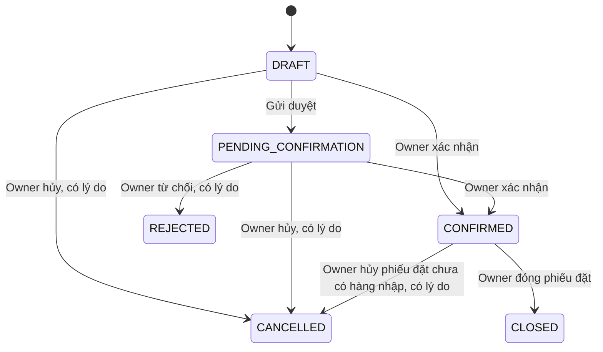

# Luồng nghiệp vụ kho đang có trong source

## Các khái niệm cần tách rõ

| Khái niệm | Ý nghĩa |
|---|---|
| Phiếu đặt (`PURCHASE_ORDER`) | Cam kết đặt nhà cung cấp; chưa phải hàng đã có trong kho. |
| Phiếu nhập (`RECEIPT`) | Một đợt nhận hàng từ phiếu đặt đã xác nhận. |
| Phiếu trả hàng nhà cung cấp (`SUPPLIER_RETURN`) | Trả một phần hàng theo phiếu nhập đã xác nhận; cần chạy `database/migrations/2026-11-04_supplier_return.sql`. |
| Tổng tồn | stock_quantity theo detail_id (màu/size). |
| Đã xếp | Tổng quantity của các product_location. |
| Chưa xếp vị trí | Tổng tồn trừ đã xếp, không phải hàng còn thiếu từ nhà cung cấp. |
| Còn thiếu đơn đặt | Lượng đặt trừ lượng đã nhập qua receipt CONFIRMED. |

Nguồn nghiệp vụ chính: WarehouseDocuments.java, WarehouseLayout.java, WarehousePolicy.java và DocumentForm.jsx.

## 1. Tạo và xác nhận phiếu đặt

*(Cập nhật 04/11/2026 — `PurchaseOrderForm.jsx`, `VariantPicker.jsx`, `QuickCreateDialog.jsx`, `WarehouseOrders.java`, `WarehouseCatalog.java`.)*

Owner **chọn nhà cung cấp trước** (gợi ý từ các phiếu đặt đã có, hoặc gõ tên mới), sau đó thêm hàng vào cùng một bảng bằng ba cách có thể kết hợp:

1. **Chọn trực tiếp** trong bộ chọn phân trang (tìm tên/màu/size/mã, lọc danh mục), chọn nhiều biến thể; lựa chọn giữ nguyên khi tìm, đổi bộ lọc, đổi trang. Tab mặc định “Hàng từng đặt từ nhà cung cấp này” = biến thể có trên phiếu đặt **CONFIRMED/CLOSED** của nhà cung cấp đó (không tính nháp/chờ duyệt/hủy/từ chối). Đây là lịch sử chứng từ, **không phải danh mục cung ứng chính thức** (không có bảng supplier). Nhà cung cấp chưa có lịch sử tự chuyển sang tab “Thêm sản phẩm khác” (toàn catalog).
2. **Excel** (`.xlsx`): giữ chức năng cũ; thêm lựa chọn bắt buộc khi dòng trong file trùng biến thể đã có trên phiếu (thay / cộng thêm / giữ dòng cũ) và chọn giá khi cộng thêm mà khác đơn giá. Dòng trùng trong cùng file vẫn chỉ gộp khi người dùng bật gộp và cùng đơn giá. Dòng không khớp catalog có nút “Hàng mới? Tạo nhanh”. Xem trước/áp dụng không ghi DB.
3. **Tạo nhanh hàng mới** (cập nhật 04/11/2026, lần 3): sản phẩm mới kèm biến thể, hoặc thêm màu/size cho sản phẩm có sẵn. Mỗi dòng: Màu | Size | Số lượng đặt | Đơn giá nhập | Giá bán dự kiến | Thành tiền nhập, kèm tổng số lượng và tổng tiền nhập. Số lượng có nút −/+ (bước 1, tối thiểu 1). Giá có nút −/+ (bước 1.000đ, không âm), gõ/dán được “80.000”, “80,000 đ”; chuỗi mơ hồ như “1.5” bị báo lỗi thay vì tự sửa. **Giá nhập bắt buộc**, đi vào `stock_receipt_item.unit_price` khi lưu phiếu. **Giá bán bắt buộc** (05/11/2026), lưu `product_detail.price` qua `ProductService.createProduct` có sẵn của module sản phẩm; không lấy giá này thay giá kia. Không tạo biến thể giá NULL để không ảnh hưởng giỏ hàng/shop/bán tại quầy của module khác. Màu/size gợi ý từ biến thể đang có, cho nhập mới, chuẩn hóa khoảng trắng; trùng chỉ so không phân biệt hoa thường, không gộp tên màu khác chữ. “+ Thêm danh mục” dùng API danh mục hiện có (kiểm tra tên trùng; backend chỉ cho OWNER tạo), tạo xong tự chọn và giữ dữ liệu form. “Tạo và thêm vào phiếu” tạo hàng (tồn 0, chưa bán online) rồi đưa biến thể vào phiếu đúng số lượng và giá nhập, không tự lưu/xác nhận. Lỗi giữ dữ liệu; tạo xong mà thêm vào phiếu lỗi thì bấm lại không tạo lần nữa; bấm đúp chỉ tạo một lần.

Khi chọn hàng hiển thị: **tồn hiện tại toàn cửa hàng** (không phải tồn theo nhà cung cấp), **đang đặt từ nhà cung cấp này** và **đang đặt từ nhà cung cấp khác** — chỉ cộng phần còn thiếu của phiếu đặt CONFIRMED (không tính nháp, hủy, đã đóng), cùng giá đặt gần nhất từ nhà cung cấp này (được điền sẵn, sửa được). Đổi nhà cung cấp khi đã có dòng hàng sẽ hỏi: giữ nhà cung cấp cũ / đổi và giữ dòng / đổi và xóa dòng.

Nhận diện nhà cung cấp: `manufacturer_name` trim, gộp khoảng trắng, không phân biệt hoa thường, **giữ dấu** (“An Phát” ≠ “Ân Phát”).

Một phiếu tối đa 200 biến thể, mỗi biến thể một dòng. Giá VNĐ nguyên 0–999999999999; lượng mỗi dòng 1–1000000. Lưu tạo `DRAFT`; Owner xác nhận trực tiếp nháp hoặc gửi `PENDING_CONFIRMATION` rồi xác nhận. Xác nhận chốt nhà cung cấp/dòng/số lượng/giá (chỉ `DRAFT` sửa được), **không cập nhật tổng tồn và không tự tạo vị trí**.

### Danh sách và chi tiết phiếu đặt

`GET /api/warehouse/orders` tìm/lọc/phân trang ở backend; hiển thị mã, nhà cung cấp, ngày đặt, tổng tiền, **trạng thái chứng từ** và **tiến độ nhận** (hai cột riêng). Tiến độ suy ra từ phiếu nhập CONFIRMED, không thêm trạng thái DB: Chưa áp dụng / Chưa nhận / Nhận một phần / Đã nhận đủ / Đóng – còn thiếu.

Chi tiết từng dòng: đặt, đã nhập, (nhận thay thế), (nhận vượt), còn thiếu hoặc đã đóng thiếu, chờ duyệt nhập, (đã trả NCC). Cột trong ngoặc chỉ hiện khi có dữ liệu. Còn thiếu = đặt − min(đặt, đã nhận), không âm; số đặt gốc không bị sửa. Dữ liệu hiện tại không thể có nhận thay thế/vượt vì backend chặn (xem mục giới hạn), nên các cột này chỉ xuất hiện nếu DB có dữ liệu cũ nhập ngoài luồng. Danh sách phiếu nhập/trả liên quan mở được từng phiếu.

### Vòng đời phiếu đặt

- Nháp: sửa, hủy. Chờ xác nhận: xác nhận, từ chối, hủy.
- Nút trên UI (04/11/2026): Owner **không có “Gửi xác nhận”**, xác nhận thẳng phiếu nháp bằng “Xác nhận đặt hàng” / “Xác nhận nhập hàng” / “Xác nhận trả hàng” (backend vốn cho `DRAFT → CONFIRMED`). Family chỉ có “Gửi xác nhận” trên phiếu nhập nháp của mình; backend chặn Family xác nhận và mọi thao tác phiếu đặt.
- Mỗi nghiệp vụ làm tại đúng trang (04/11/2026): phiếu nhập chỉ lập tại **Nhập hàng** (chọn phiếu đặt đã xác nhận còn thiếu, lượng còn thiếu được điền sẵn, ghi số thực nhận); phiếu trả lập tại **Trả hàng nhà cung cấp** hoặc từ nút “Trả hàng nhà cung cấp” trong chi tiết phiếu nhập đã xác nhận còn hàng được trả (đổi 04/11/2026, xem mục 3). Chi tiết phiếu đặt không còn nút “Lập đợt nhập”; các phiếu nhập/trả liên quan mở từ phiếu đặt chỉ để xem.
- Phiếu đặt chưa xác nhận (tiến độ “Chưa áp dụng”) hiển thị “Còn thiếu” là “—”; sau xác nhận, còn thiếu bằng số lượng đặt trừ số đã nhập.
- Đã xác nhận, **chưa có phiếu nhập CONFIRMED**: được **hủy kèm lý do** sau khi các phiếu nhập nháp/chờ duyệt đã được xử lý.
- Đã nhập một phần: tiếp tục lập đợt nhập, hoặc **đóng phần còn thiếu** kèm lý do (giữ lịch sử).
- Đã nhận đủ: chặn tạo phiếu nhập thông thường; có thể đóng đơn.
- Đã hủy/đóng: không nhận thêm.
- “Sao chép thành phiếu nháp”: phiếu đặt mới cùng nhà cung cấp, dòng, số lượng, giá; không mang lịch sử nhận/duyệt.

Nhà cung cấp là manufacturer_name trên phiếu đặt. Phiếu nhập/trả lấy thông tin nhà cung cấp theo chuỗi nguồn; không có bảng supplier riêng.

## 2. Nhập hàng từ đơn đặt

Chọn phiếu đặt `CONFIRMED` còn thiếu hàng (form chỉ liệt kê phiếu còn thiếu). Các dòng được **điền sẵn lượng còn thiếu**, người dùng sửa thành số thực nhận; giao nhiều đợt bằng nhiều phiếu nhập. Mỗi dòng nhập phải tham chiếu dòng nguồn có cùng detail_id; đơn giá bắt buộc bằng nguồn. Lượng nhập không vượt `quantity nguồn − lượng các receipt CONFIRMED đã nhận`; khi vượt, UI và backend báo rõ “đặt / đã nhập / còn thiếu / lần này / vượt”. Các phiếu nháp/chờ chưa làm giảm phần còn được nhập; backend kiểm tra lại lúc submit/confirm.

Khi Owner xác nhận từ UI, frontend gửi kèm số còn thiếu đang hiển thị (`expectedRemaining`). Nếu trong lúc đó có đợt nhập khác được xác nhận làm số này thay đổi, backend trả `WAREHOUSE_STALE` với số mới và yêu cầu xác nhận lại.

Owner và Family có thể tạo receipt nháp; Family chỉ sửa/gửi receipt của mình. Khi lưu hoặc gửi duyệt, tổng tồn vẫn giữ nguyên.

Chỉ Owner confirm mới:

1. Khóa kho trong transaction và kiểm tra lại trạng thái/nguồn/lượng.
2. Cộng stock_quantity từng biến thể, kiểm tra không tràn giới hạn int.
3. Ghi stock_adjustment loại RECEIPT với idempotency key theo phiếu/dòng.
4. Ghi CONFIRMED, người và thời gian xác nhận, audit log.
5. Nếu phiếu đặt còn thiếu, tạo thông báo WAREHOUSE_SHORTAGE cho Owner ACTIVE.

Hàng vừa nhập tăng phần **chưa xếp vị trí**. Việc xếp vào kệ/tầng là thao tác tiếp theo và không tăng tổng tồn thêm lần nữa. Confirm lại một phiếu CONFIRMED trả về kết quả hiện tại thay vì cộng lại.

### Giới hạn do schema (chưa triển khai, chờ quyết định)

Các nghiệp vụ sau **bị backend chặn có chủ đích** với thông báo rõ, vì `stock_receipt_item` chỉ có `quantity`, `unit_price`, `source_receipt_item_id` và không có chỗ lưu bền vững quyết định/lý do theo dòng: nhận vượt có Owner duyệt; nhận thay thế màu/size; đổi giá thực nhập có duyệt; ghi số giao / số chấp nhận / số từ chối; hàng từ chối “Chờ trả — chưa nhập kho”; lựa chọn “Chờ giao bù” / “Không nhận tiếp” khi trả hàng. Đề xuất schema tối thiểu: `docs/SCHEMA_PROPOSAL_PURCHASE_RECEIVING.md`.

## 3. Trả hàng nhà cung cấp

Cần chạy `database/migrations/2026-11-04_supplier_return.sql` (mở rộng 3 CHECK, không thêm bảng/cột). Trên DB theo dump, tạo phiếu trả bị CHECK từ chối (TASK-03).

Phạm vi: chỉ trả theo phiếu nhập `RECEIPT` đã `CONFIRMED`; chưa có trả hàng không theo phiếu nhập. Phiếu trả liên kết phiếu nhập qua `source_receipt_id`, từng dòng qua `source_receipt_item_id`; nhà cung cấp lấy theo chuỗi nguồn nên luôn đúng NCC của phiếu nhập. Chỉ được chọn các dòng của phiếu nhập đó; đơn giá trả = đơn giá dòng nhập (phiếu nhập không có chiết khấu/thuế). Lý do trả nằm ở `note`, có thể để trống khi lưu nháp nhưng bắt buộc trước khi gửi duyệt/duyệt/xuất trả.

| Trạng thái (`status`) | Nhãn | Ai/khi nào | Tồn kho |
|---|---|---|---|
| `DRAFT` | Nháp | Owner hoặc Family lập; Family chỉ sửa nháp của mình | Không đổi |
| `PENDING_CONFIRMATION` | Chờ duyệt | Family “Gửi duyệt” | Không đổi |
| `APPROVED` (mới) | Chờ xuất trả | Owner “Xác nhận phiếu” (nháp) / “Duyệt phiếu” (chờ duyệt) → `POST /approve`; ghi `confirmed_by/confirmed_at` = người/thời điểm duyệt | Không đổi; số lượng được giữ chỗ trên dòng nhập |
| `CONFIRMED` | Đã xuất trả | Owner “Xác nhận xuất trả” → `POST /confirm` kèm `picks` | Giảm đúng một lần |
| `REJECTED` / `CANCELLED` | Từ chối / Đã hủy | Owner; phiếu `APPROVED` vẫn hủy được vì chưa trừ tồn | Không đổi |

- Owner không có “Gửi xác nhận”. “Xác nhận và xuất trả” / “Duyệt và xuất trả” gọi cùng `POST /confirm`: backend chạy bước duyệt rồi bước xuất trong một transaction (một đường cập nhật kho duy nhất, lỗi thì hoàn tác cả bước duyệt).
- Family không duyệt/xuất trả được: chặn tại `WarehousePolicy.owner` ở backend, không chỉ ẩn nút.
- Còn được trả của dòng nhập = đã nhập − đã xuất trả (`CONFIRMED`) − đã duyệt chờ xuất (`APPROVED`) của các phiếu khác. Kiểm tra khi tạo/sửa, gửi duyệt, duyệt và lại lần nữa khi xuất trả, dưới khóa kho chung `WarehouseStore.lock()`, nên hai phiếu đồng thời không trả vượt.
- Xuất trả: người dùng xem và chỉnh vị trí lấy + số lượng lấy ở từng vị trí (“Chưa xếp vị trí” hoặc từng `product_location`). Giao diện chỉ gợi ý (chưa xếp trước, rồi vị trí nhiều hàng nhất); backend không tự chọn vị trí. Backend kiểm tra: tổng phân bổ = số trả của dòng, vị trí đúng biến thể, không vượt số tại vị trí (`UPDATE … AND quantity>=?`), không vượt phần chưa xếp, tổng tồn đủ (`stock_quantity>=?`). Mỗi phần lấy ghi một `stock_adjustment` `SUPPLIER_RETURN` (receipt_item_id = dòng phiếu trả, source_location_id = vị trí, khóa idempotency `return:<item>:<location|unassigned>`). Xác nhận lặp trả về kết quả hiện tại, không trừ lần hai.
- Phiếu `APPROVED`/`CONFIRMED` không sửa được (chỉ sửa nháp); `CONFIRMED` không hủy/xóa được.
- Chi tiết phiếu: người lập, người duyệt, thời điểm xuất trả (`dispatched_at` = thời điểm movement), lịch sử thao tác (`GET /documents/{id}/history`: audit_log `DOCUMENT_*` + movement theo vị trí), mở được phiếu nhập gốc.
- Công nợ, tiền và đổi hàng (05/11/2026, cần `database/migrations/2026-11-05_supplier_settlement.sql`, khớp `SQL_v2.sql`). Mọi khoản ghi vào bảng `supplier_settlement` (`WarehouseSettlements`, `POST /api/warehouse/settlements`), Owner ghi, Family chỉ xem, chỉ hủy kèm lý do (không xóa), có `request_key` chống ghi trùng, chạy dưới khóa kho chung.
  - **Công nợ phiếu nhập** (nhập từ phiếu đặt, đã xác nhận) = giá trị − `stock_receipt.paid_before_tracking` − Σ `PAYMENT` − Σ `DEBT_OFFSET` − Σ `CREDIT_USE`; không âm, mỗi khoản tính một lần. **Thanh toán** (`PAYMENT`): nhiều lần, có hình thức, ngày giao dịch, người ghi.
  - **Dữ liệu cũ:** phiếu nhập xác nhận trước khi nâng cấp có `paid_before_tracking = NULL` → công nợ “Chưa xác định”, không ghi được thanh toán/đối trừ cho đến khi Owner **khai báo số đã thanh toán trước** (`POST /documents/{id}/payment-basis`, có thể là 0). Phiếu nhập xác nhận sau nâng cấp được đặt 0.
  - **Phiếu trả đã xuất trả** có giá trị = Σ số lượng × đơn giá trả, xử lý bằng **Nhận hoàn tiền** (`REFUND`, nhiều lần), **Giảm công nợ** (`DEBT_OFFSET` vào một phiếu nhập cùng NCC còn nợ đã xác định), **Giữ tiền đối trừ** (`CREDIT_HOLD`, dùng sau bằng `CREDIT_USE` trên phiếu nhập cùng NCC) hoặc **Đổi hàng** (`EXCHANGE`). Tổng không vượt giá trị phiếu trả. Bản thân việc xuất trả không tự giảm công nợ.
  - **Đổi hàng** chỉ ghi nhận NCC sẽ giao lại cùng màu/size, không đổi tồn. Hàng về được lập **phiếu nhập có nguồn là phiếu trả** tại trang Nhập hàng (Family lập được, Owner xác nhận như nhập thường, tăng tồn ở phần chưa xếp vị trí, movement `RECEIPT`), không vượt số đã thỏa thuận đổi. Phiếu nhập hàng đổi không phát sinh công nợ. Không hủy được phần đổi đã nhận hàng.
  - Trạng thái xử lý tiền của phiếu trả (`settlement_status`: Chưa xử lý / Một phần / Đã xử lý xong) tách khỏi trạng thái phiếu.

Hành vi hiện tại khi trả: lượng trả **không mở lại** phần còn thiếu của đơn đặt (tương đương “Không nhận tiếp”); chi tiết phiếu đặt hiển thị riêng số đã trả. Tổng trả qua nhiều phiếu không vượt lượng đã nhận chưa trả; xác nhận lặp không trừ hai lần (đã kiểm thử trên H2 với CHECK đề xuất, xem VERIFICATION).

Đây không phải đổi/trả của khách hàng: `return_request`/`return_request_item` là nhóm bảng khác và chưa có module source tương ứng.

## 4. Trạng thái chứng từ

- Chỉ `DRAFT` sửa được. Không có endpoint mở lại REJECTED/CANCELLED thành DRAFT trong snapshot.
- REJECTED chỉ từ PENDING_CONFIRMATION; CANCELLED từ DRAFT/PENDING_CONFIRMATION, và từ CONFIRMED chỉ với phiếu đặt chưa có phiếu nhập CONFIRMED và không còn phiếu nhập nháp/chờ duyệt.
- CLOSED chỉ áp dụng phiếu đặt CONFIRMED; không đóng khi còn receipt nguồn ở DRAFT/PENDING_CONFIRMATION.
- Mọi end action yêu cầu lý do. Đóng đơn không xóa lượng đã nhập và không tự nhận nốt lượng thiếu.
- Phiếu nhập đã xác nhận không hủy/sửa để đảo tồn; dùng nghiệp vụ trả phù hợp sau khi xử lý schema.
- Chưa có trạng thái REVISION_REQUESTED/RECEIVED riêng như một số luồng từng trao đổi. Không coi các tên mô tả cũ là enum đang có.

## 5. Tác động tồn theo thao tác

| Thao tác | Tổng tồn | Phân bổ vị trí |
|---|---|---|
| Lưu/submit chứng từ | Không đổi | Không đổi. |
| Confirm PURCHASE_ORDER | Không đổi | Không đổi. |
| Confirm RECEIPT | Tăng | Chưa tự xếp; phần unassigned tăng. |
| Duyệt SUPPLIER_RETURN | Không đổi | Không đổi. |
| Xác nhận xuất trả SUPPLIER_RETURN | Giảm | Trừ đúng vị trí/phần chưa xếp người dùng đã chọn. |
| Gán hàng chưa xếp vào tầng | Không đổi | Đích tăng, unassigned giảm. |
| Chuyển giữa tầng | Không đổi | Nguồn giảm, đích tăng. |
| Rút hàng khỏi tầng về chưa xếp | Không đổi | Nguồn giảm, unassigned tăng. |
| Sửa mô tả/ảnh/bố cục | Không đổi | Quantity không đổi. |
| Khách đặt online (COD) | Không đổi | Do module đơn hàng xử lý (không thuộc phần kho). Kho chỉ **đọc** Σ `order_item.reserved_quantity` để hiển thị "đang giữ"/"có thể bán". |
| Owner xác nhận đơn online (chờ lấy hàng) | Theo module đơn hàng | Bản hiện tại của team chỉ đổi trạng thái; việc trừ tồn khi xác nhận đơn **chưa** tích hợp (cần chủ module đơn hàng đồng ý). `WarehouseStore.sell` đã sẵn sàng để gọi. |
| Từ chối / khách hủy / hết hạn | Không đổi | Theo module đơn hàng. |
| Bán tại quầy | Giảm | Module bán hàng trừ `stock_quantity` và ghi ORDER_OUT; không trừ `product_location`, nên phần bán ra được tính vào "chưa xếp" (có thể âm nếu bán hàng đang nằm trên kệ — xử lý bằng kiểm kê/chuyển vị trí). |
| Xác nhận phiếu kiểm kê | Tăng/giảm theo chênh lệch | Chênh lệch tại vị trí cập nhật vị trí đó; dòng "chưa xếp" chỉ đổi tổng. ADJUSTMENT, key `count:<phiếu>:<dòng>`. |

## 5b. Tồn kho, giữ hàng, kiểm kê, báo cáo (06/11/2026, cần `database/migrations/2026-11-06_inventory.sql`)

- **Số liệu** (`WarehouseInventory`, `GET /api/warehouse/inventory`): tổng tồn = đã xếp + chưa xếp; đang giữ = Σ `order_item.reserved_quantity`; có thể bán = tổng − giữ; đang đặt = phần còn chờ của phiếu đặt **CONFIRMED** (không gồm nháp/chờ duyệt/từ chối/đã đóng/đã nhận) — không cộng vào tồn hay có thể bán. Thống kê tính trên toàn bộ biến thể khớp tìm kiếm/bộ lọc, không chỉ trang đang xem.
- **Định danh:** mã SP `SPxxxxx` (product_id) + mã biến thể `#detail_id` + mã vạch. DB thật có nhiều sản phẩm cùng tên/màu/size khác mã — giữ nguyên, phân biệt bằng mã, không tự gộp/xóa.
- **Giữ hàng (chưa tích hợp trong bản này — thuộc module đơn hàng/bán hàng, chờ chủ module đồng ý):** thiết kế đề xuất: đặt online giữ ngay dưới khóa kho chung (không vượt có thể bán); Owner xác nhận = xuất bán (trừ tồn một lần, tiêu thụ phần giữ); từ chối/hủy/hết hạn giải phóng. Đơn cũ đặt trước nâng cấp không có giữ: khi xác nhận vẫn kiểm tra có thể bán. Đơn online đã xác nhận trước nâng cấp chưa từng trừ tồn — không tự trừ bù. Không có đơn nháp nên không giữ cho nháp. `stock_hold_status` để dành cho giữ tạm khi thanh toán online (CHECK yêu cầu payment).
- **Ngưỡng tối thiểu** (`product_detail.min_stock_quantity`, Owner): NULL = chưa thiết lập (không đánh giá sắp hết), 0 là một ngưỡng; sắp hết khi tổng tồn > 0 và có thể bán ≤ ngưỡng. Tồn lâu = số ngày từ lần xuất bán gần nhất (hoặc lần nhập đầu tiên nếu chưa bán); không có lịch sử → "chưa đủ dữ liệu".
- **Thẻ kho** (`GET /history/{detail}?kind=stock|move`): tồn sau giao dịch tính ngược từ tồn hiện tại; chứng từ gốc (PD/PN/PT, đơn online, đơn tại quầy, yêu cầu trả, phiếu kiểm kê); chuyển vị trí tách riêng. Lịch sử cũ thiếu → báo "lịch sử thiếu N", không tạo lịch sử giả.
- **Kiểm kê** (`WarehouseCounts`, bảng `stock_count`/`stock_count_item`): mỗi dòng là một biến thể tại một vị trí hoặc phần chưa xếp; lưu số hệ thống lúc đếm, số đếm, chênh lệch, lý do (bắt buộc khi lệch). Family lập/gửi xác nhận; Owner xác nhận trực tiếp hoặc duyệt. Nháp/chờ không đổi tồn. Khi xác nhận: có phát sinh sau lúc đếm → chặn (`COUNT_STALE`), phải lưu lại; lý do "thiếu chứng từ" → chặn, lập chứng từ gốc trước. Xác nhận lặp không áp dụng lần hai.
- **Báo cáo** (`GET /inventory/report?from&to`): tồn đầu = tồn hiện tại − biến động từ đầu kỳ; tồn cuối = tồn hiện tại − biến động sau cuối kỳ; tồn cuối = đầu + tăng − giảm; MOVE không tính. Ngày theo giờ Việt Nam, đổi sang đồng hồ DB (UTC). **Giá vốn** = bình quân gia quyền **liên hoàn** (tính lại sau mỗi lần nhập, phát lại thẻ kho theo đúng thứ tự thời gian, `WarehouseInventory.replay`): nhập mua cộng theo đơn giá dòng phiếu nhập; xuất bán / kiểm kê giảm theo giá bình quân tại thời điểm đó; trả NCC giảm theo đơn giá dòng nhập được trả; khách trả nhập lại theo giá vốn lúc bán dòng đơn đó; kiểm kê thừa theo giá bình quân hiện hành. Tồn có trước lịch sử kho hoặc dòng nhập không có giá → "chưa đủ cơ sở" (không tính 0/giá bán/giá nhập gần nhất) cho đến khi phần đó xuất hết. Giá trị đầu/cuối kỳ của báo cáo là trạng thái bình quân tại đúng thời điểm đó; giá trị tồn hiện tại = giá trị cuối kỳ khi kỳ kết thúc hôm nay. Giá vốn/giá trị chỉ trả về cho Owner (API, giao diện, Excel).
- **Mã vạch:** chỉ tạo cho biến thể chưa có mã (tất cả hoặc các dòng đã chọn); không đổi mã đã có; mã trùng với mã nhập tay → thêm hậu tố `-n`.

## 6. Gán/chuyển vị trí

Owner gửi Move gồm detailId, fromLocationId hoặc null, toShelfId hoặc null, quantity, description/photoKeys khi cần và requestKey UUID. Null nguồn nghĩa là lấy hàng chưa xếp; null đích nghĩa là trả về chưa xếp. Không cho cả nguồn/đích trống hay chuyển vào chính tầng nguồn.

Backend kiểm tra quantity đủ, đúng biến thể, tổng assigned không lớn hơn stock; tầng đích/kệ phải active và tầng AVAILABLE. Lần đầu tạo location cần mô tả không trống và ảnh thực tế. Nếu location đã có, vẫn phải có mô tả và ít nhất một ảnh còn hiệu lực. Tối đa tám ảnh/location.

Movement MOVE có quantity_change=0, movement_quantity là lượng di chuyển, khóa `move:<requestKey>`. Gửi lại cùng key/nội dung không thực hiện lần hai; cùng key nhưng nội dung khác bị từ chối. Dòng location có thể còn quantity=0 để giữ metadata/lịch sử.

## 7. Kệ/tầng và sơ đồ 2D

Tọa độ x/y lưu ở rack; chiều cao kệ phụ thuộc số tầng. Tầng sắp hiển thị theo level_number giảm dần. Quy tắc hình học được viết ở cả RackGeometry.java và rackLayout.js: rộng 190, khoảng cách 24, chiều cao tầng 40 và khoảng cách tầng 4; giới hạn giá trị tọa độ 0–1800.

Có thêm/sửa kệ, thêm/sửa tầng, active/inactive, kéo kệ, đặt tương đối theo kệ khác và xếp gọn. Chỉ ẩn kệ/tầng khi không còn quantity; không có endpoint hard delete. Tầng có AVAILABLE/FULL/BLOCKED/MAINTENANCE; không có sức chứa định lượng hoặc cơ chế tự suy ra FULL từ số hàng.

Snapshot chuẩn hóa bố cục bị chồng lấn để hiển thị; các mutation bố cục còn gọi normalizeStored để lưu sửa tọa độ cũ. Vì vậy tọa độ thấy trong snapshot có thể đã được tính lại, không nhất thiết bằng giá trị thô trong bảng rack trước mutation.

## 8. Ảnh và thông báo

Ảnh kho upload JPG/PNG tối đa 5 MiB và 20 triệu pixel; backend kiểm tra nội dung/decode. Tên file phát sinh ngẫu nhiên; lưu mặc định `./data/warehouse-photos` theo working directory backend. Pattern key/read có chấp nhận webp, nhưng đường upload hiện chỉ nhận JPG/PNG; không mô tả WebP là định dạng upload được hỗ trợ.

Metadata có mô tả tối đa 2.000 ký tự, keepImageIds và photoKeys; xóa ảnh theo deleted_at. Vị trí còn hàng không được mất hết ảnh. Upload file chưa tự tạo product_location và file local không được transaction DB rollback; nếu cần quản lý file mồ côi thì phải bổ sung riêng, hiện chưa thấy job dọn.

Thông báo WAREHOUSE_PENDING sinh khi submit; WAREHOUSE_SHORTAGE sinh sau confirm receipt còn thiếu. Hiện gửi Owner ACTIVE; chưa thấy thông báo xác nhận/từ chối cho người tạo Family như một số mô tả trước. Lịch sử biến thể lấy tối đa 200 movement; danh sách thông báo tối đa 50 bản ghi.
